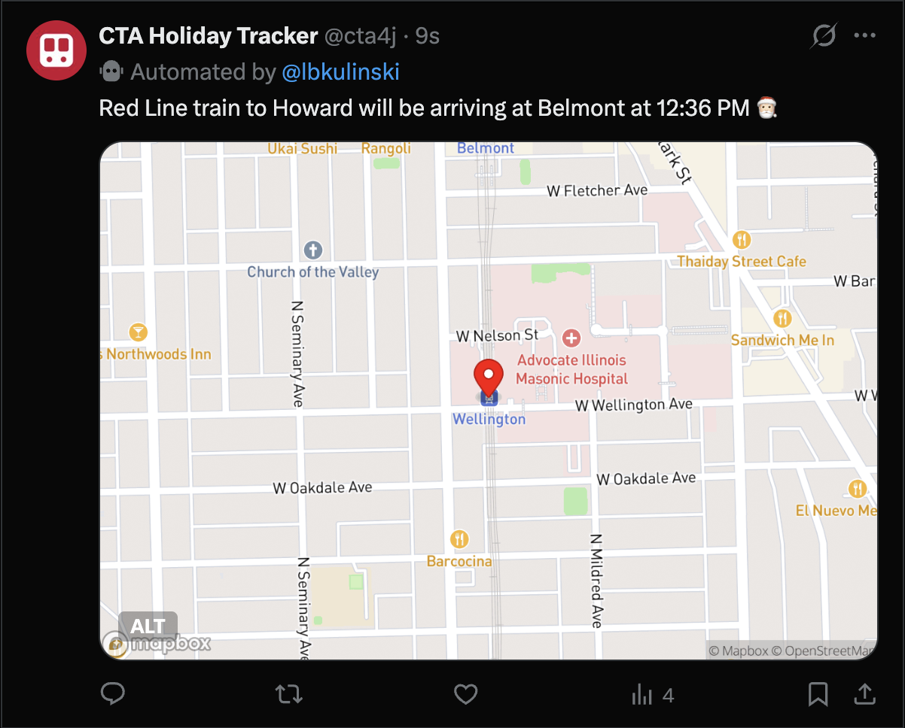

# CTA Holiday Bot

Automated social-media updates for the Chicago Transit Authority Holiday Train using real-time CTA data.
This bot posts arrival updates, map snapshots, and route information to platforms such as Twitter/X, Bluesky, and Mastodon, using the cta4j SDK and media APIs.

## Features

### Real-Time CTA Tracking
- Fetches upcoming train arrivals using the CTA Train Tracker API
- Tracks the Holiday Train
- Supports run-number following (e.g. 1225 in the case of the Holiday Train)

### Map Snapshot Generation
- Creates map snapshots using Mapbox
- Generates PNG images (600×400 at 2x, i.e. 1200×800)
- Adds alt text describing the map to every image
- Handles media upload for each platform

### Social Media Posting
| Platform  | Supported | Notes |
|-----------|-----------|-------|
| Twitter/X | Yes       |       |
| Bluesky   | Yes       |       |
| Mastodon  | Yes       |       |
| Threads   | No        | WIP   |

## Architecture Overview
- Java 25
- Spring Boot 4 and Spring Cloud Function (AWS adapter)
- Spring `RestClient` for Bluesky and Mastodon
- ScribeJava (OAuth 1.0a) for Twitter/X
- AWS Secrets Manager for credentials, with caching
- Rollbar for error reporting
- Deployed to AWS Lambda

## Getting Started

### 1. Clone the Repo
```bash
git clone https://github.com/lbkulinski/cta-holiday-bot.git
cd cta-holiday-bot
```

### 2. Environment Variables
| Variable                          | Description                                                |
|-----------------------------------|------------------------------------------------------------|
| APP_ROLLBAR_ENVIRONMENT           | The environment the code is running in (e.g. localhost)    |
| AWS_REGION                        | The AWS region of the secret (set automatically in Lambda) |
| APP_AWS_SECRETS_MANAGER_SECRET_ID | The ID of the secret to read from Secrets Manager          |
| APP_CTA_TRAIN_RUN                 | The CTA train run number to track                          |

### 3. AWS Secrets Manager
The application expects a JSON object in AWS Secrets Manager with the following structure:
```json
{
  "twitter": {
    "consumerKey": "...",
    "consumerKeySecret": "...",
    "accessToken": "...",
    "accessTokenSecret": "..."
  },
  "bluesky": {
    "identifier": "...",
    "appPassword": "..."
  },
  "mapbox": {
    "accessToken": "..."
  },
  "cta": {
    "trainApiKey": "..."
  },
  "rollbar": {
    "accessToken": "..."
  },
  "mastodon": {
    "accessToken": "..."
  }
}
```

For Twitter/X, use the consumer keys and the posting account's access token and secret from the X developer portal
(OAuth 1.0a). These do not expire, so no refresh flow is needed.

### 4. Run Locally
The application is built to run as an AWS Lambda function, so it does not include a local entrypoint. To run it on your
machine, write your own runner, for example a `CommandLineRunner` bean that builds a post with `PostService` and
publishes it with `MultiplatformPublisher`, then start the application with `./mvnw spring-boot:run`. You will also need
the environment variables above and AWS credentials that can read the secret.

### 5. Deploy to AWS Lambda (Optional)
- Package with `./mvnw clean verify`, which produces the shaded JAR at `target/cta-holiday-bot-<version>.jar`
- Upload the shaded JAR to AWS Lambda (Java 25 runtime)
- Use Spring Cloud Function's AWS adapter as the handler to invoke the `socialPublisher` function
- Pushing a `v*` tag runs the release workflow, which builds, publishes a new Lambda version, moves the `live` alias to
  it, and creates a GitHub release
- Point your trigger (e.g. EventBridge) at the `live` alias ARN, which the first release creates. Enabling SnapStart for
  published versions reduces cold starts, but only invocations through the alias or a version use it

## Testing
```bash
./mvnw verify
```
This runs the unit tests (JUnit 6 and Mockito) and fails if line coverage drops below 85%. The HTML coverage report is
written to `target/site/jacoco/index.html`. Pull request and merge builds run the same command and upload the report as
the `jacoco-report` artifact.

## Example Output
Each post contains text and a map image showing the train's current location, as seen here on Twitter/X:



> Red Line train to Howard will be arriving at Belmont at 12:36 PM 🎅🏻

The image has alt text:

> Map showing the current location of the Red Line train to Howard, marked with a pin. It is heading to Belmont.

When the arrival has no line, the text says "Holiday train" instead, for example "Holiday train to Howard will be
arriving at Belmont…". If the train's position isn't available, the post is text only.

## Future Enhancements
- Full Threads API integration

## Contributing
Contributions are welcome! Please open issues or submit pull requests for bug fixes and new features.

## License
Apache License 2.0
